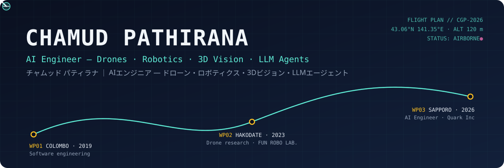

<div align="center">



[🇬🇧 English](README.md) &nbsp;·&nbsp; **🇯🇵 日本語**

</div>

## 🎯 ミッション

機械が「見て、計画して、動く」ためのソフトウェアを作っています。VRで描いた経路を飛ぶドローン、遠隔操作から学習するロボットハンド、図面から3D CADを生成するAIエージェントなどに取り組んでいます。

**Quark株式会社 AIエンジニア** · **FUN ROBO STUDIO株式会社 チーフエンジニア（業務委託）** · 北海道札幌市

## 🛫 フライトログ

```text
年     ウェイポイント      ログ
2019   WP01 コロンボ      LNBTI コンピュータソフトウェア工学 HND
2022        コロンボ      Metatechno Lanka ソフトウェアエンジニア研修生（Java・RPA）
2023   WP02 函館          公立はこだて未来大学 複雑系知能学科
2025        函館          西沢研究室：VRによるドローン飛行経路の研究、学会発表、特許出願
2026   WP03 札幌          Quark株式会社 AIエンジニア / FUN ROBO STUDIO ドローンソフトウェア開発
```

## 🚁 ドローン・自律飛行

- **VRによる飛行経路設計。** 公立はこだて未来大学（西沢研究室 / FUN ROBO LAB.）での卒業研究です。仮想現実の中で直感的にドローンの飛行経路を設計できるインターフェースを開発しました。特許出願中（日本、2025年8月出願）。
- **FUN ROBO STUDIOでのドローンソフトウェア開発。** 飛行計画、飛行制御、映像共有機能を担当しています。
- **展示会出展。** ドローンサミット2025（名古屋）、北海道ビジネスEXPO 2025（札幌）。
- **個人での実験。** [gimbal-simulation](https://github.com/Chamud/gimbal-simulation)、[3DGS-101](https://github.com/Chamud/3DGS-101)（ドローン映像を含む3D Gaussian Splatting）。

## 🤖 現在の空域（Quark株式会社）

| 分野 | 内容 |
|---|---|
| LLMエージェント | 2D図面から3D CADを自動生成・検証する自律エージェント |
| フィジカルAI | 多指ハンド付きロボットアーム：MuJoCoシミュレーション、VR遠隔操作、VLAモデル学習 |
| コンピュータビジョン | 6自由度姿勢推定、ドライブレコーダー映像解析（検出・追跡・セグメンテーション） |
| 自動運転 | 自動運転除雪車向けの Autoware / AWSIM シミュレーション環境 |
| 3D再構成 | 3D Gaussian Splatting パイプライン |

## 🧰 ペイロード（技術スタック）

| | ツール | 主な用途 |
|:-:|---|---|
|  | **Python** | AI・コンピュータビジョンのパイプライン、LLMエージェント、3D Gaussian Splatting |
|  | **C++** | 組み込み・ロボットのファームウェア（ESP32） |
|  | **C#** | Unityのスクリプト開発 |
|  | **Unity** | VR飛行経路設計ツール、XRアプリ、シミュレーション |
|  | **PyTorch** | 画像認識モデルやロボット制御（VLA）モデルの学習 |
|  | **OpenCV** | 画像処理、姿勢推定、映像解析 |
|  | **ROS 2** | 自動運転スタック（Autoware）、ロボティクス |
|  | **Three.js** | ブラウザで動く3Dツール（GLBエディタ、ジンバルシミュレーション） |
|  | **Flutter** | モバイルアプリ |
|  | **Docker** | 機械学習・シミュレーション環境の再現 |
|  | **Linux** | GPU学習やロボティクス開発用のUbuntu |

## 📄 発表論文・特許

- **特許出願中：ドローンの飛行経路設計・飛行制御。** 特願2025-135949、2025年8月出願（出願人：公立はこだて未来大学）。共同発明者。
- **仮想現実技術を活用した飛行経路の作成技術の研究。** 日本航空宇宙学会 第63回飛行機シンポジウム、2025年10月。筆頭著者・発表者。
- **ドローンのVRを活用した飛行経路設計システムの評価。** 日本デザイン学会 第73回春季研究発表大会、2026年6月。第2著者。
- **ドローン記念撮影サービス ― 秩父におけるドローンを用いた実験でのユーザー評価。** 日本デザイン学会 第72回春季研究発表大会、2025年6月。第2著者。[DOI](https://doi.org/10.11247/jssd.72.0_644)

## 🛠 ハンガー（公開プロジェクト）

| プロジェクト | 概要 |
|---|---|
| [harnessing_loop](https://github.com/Chamud/harnessing_loop) | エージェントの中核：VLM、ループ、ツール、サンドボックス、ゲート |
| [BJT](https://github.com/Chamud/BJT) | BJTビジネス日本語能力テストの学習アプリ |
| [glb-crop-editor](https://github.com/Chamud/glb-crop-editor) | 単一ファイルで動くWeb版GLBメッシュ切り抜きエディタ（Three.js） |

## 📡 連絡先・言語

English · 日本語（JLPT N2） · සිංහල &nbsp;|&nbsp; [LinkedIn](https://www.linkedin.com/in/chamud-pathirannahelaya-06b512172) · [研究室の業績一覧](https://nishizawatoshihiro.github.io/)

<div align="center"><sub>公立はこだて未来大学 システム情報科学部 卒業（2026年） · ロータリー米山記念奨学生 · 野崎わかば会奨学生</sub></div>
