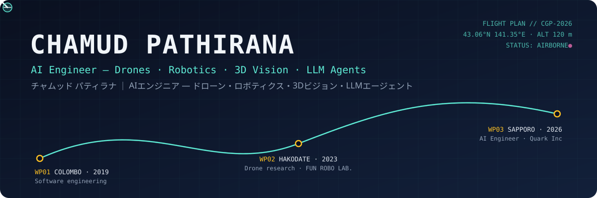

<div align="center">



**🇬🇧 English** &nbsp;·&nbsp; [🇯🇵 日本語](README.ja.md)

</div>

## 🎯 Mission

I build software that lets machines see, plan and move: drones that fly paths you draw in VR, robot hands that learn from teleoperation, and AI agents that turn drawings into 3D CAD.

**AI Engineer @ Quark Inc** · **Chief Engineer (contract) @ FUN ROBO STUDIO** · Sapporo, Japan

## 🛫 Flight log

```text
YEAR   WAYPOINT          LOG
2019   WP01 Colombo      HND in Computer Software Engineering (LNBTI)
2022        Colombo      Trainee Software Engineer, Metatechno Lanka (Java, RPA)
2023   WP02 Hakodate     Future University Hakodate, Complex & Intelligent Systems
2025        Hakodate     Nishizawa Lab: VR drone flight-path research, papers, patent filed
2026   WP03 Sapporo      AI Engineer at Quark Inc; drone software at FUN ROBO STUDIO
```

## 🚁 Drones & autonomous flight

- **VR flight-path design.** My graduation research at Future University Hakodate (Nishizawa Lab / FUN ROBO LAB.): an intuitive interface for designing drone flight paths in virtual reality. Patent pending (Japan, filed Aug 2025).
- **Drone software at FUN ROBO STUDIO.** Flight planning, flight control and live video sharing.
- **Exhibitions.** Drone Summit 2025 (Nagoya) and Hokkaido Business EXPO 2025 (Sapporo).
- **Side experiments.** [gimbal-simulation](https://github.com/Chamud/gimbal-simulation) and [3DGS-101](https://github.com/Chamud/3DGS-101) (3D Gaussian Splatting, including drone footage).

## 🤖 Current airspace (Quark Inc)

| Area | Work |
|---|---|
| LLM agents | Autonomous agent that turns 2D engineering drawings into verified 3D CAD |
| Physical AI | Robot arm with a multi-fingered hand: MuJoCo simulation, VR teleoperation, VLA training |
| Computer vision | 6-DoF pose estimation; dashcam video analysis (detection, tracking, segmentation) |
| Autonomous driving | Autoware / AWSIM simulation for an autonomous snow plow |
| 3D reconstruction | 3D Gaussian Splatting pipelines |

## 🧰 Payload

<div align="center">


</div>

## 📄 Publications & patent

- **Patent pending: drone flight path design and flight control.** Japanese Patent Application No. 2025-135949, filed Aug 2025 by Future University Hakodate. Co-inventor.
- **Research on Flight Path Creation Technology Using Virtual Reality.** JSASS 63rd Aircraft Symposium, Oct 2025. First author and presenter.
- **Evaluation of a VR-Based Drone Flight Path Design System.** JSSD 73rd Spring Research Conference, Jun 2026. Second author.
- **Drone Commemorative Photography Service: User Evaluation in a Drone Experiment in Chichibu.** JSSD 72nd Spring Research Conference, Jun 2025. Second author. [DOI](https://doi.org/10.11247/jssd.72.0_644)

## 🛠 Hangar (open projects)

| Project | What it is |
|---|---|
| [harnessing_loop](https://github.com/Chamud/harnessing_loop) | The core of an agent: VLM, loop, tools, sandbox, gates |
| [glb-crop-editor](https://github.com/Chamud/glb-crop-editor) | Single-file web GLB mesh crop editor (Three.js) |
| [3DGS-101](https://github.com/Chamud/3DGS-101) | 3D Gaussian Splatting experiments |
| [gimbal-simulation](https://github.com/Chamud/gimbal-simulation) | Interactive 3-axis gimbal and gimbal-lock demo |
| [BJT](https://github.com/Chamud/BJT) | Study app for the Business Japanese Proficiency Test |

## 📡 Comms

English · 日本語 (JLPT N2) · සිංහල &nbsp;|&nbsp; [Lab publications](https://nishizawatoshihiro.github.io/)

<div align="center"><sub>B.Sc. Systems Information Science, Future University Hakodate (2026) · Rotary Yoneyama Scholar · Nozaki Wakaba Scholar</sub></div>
